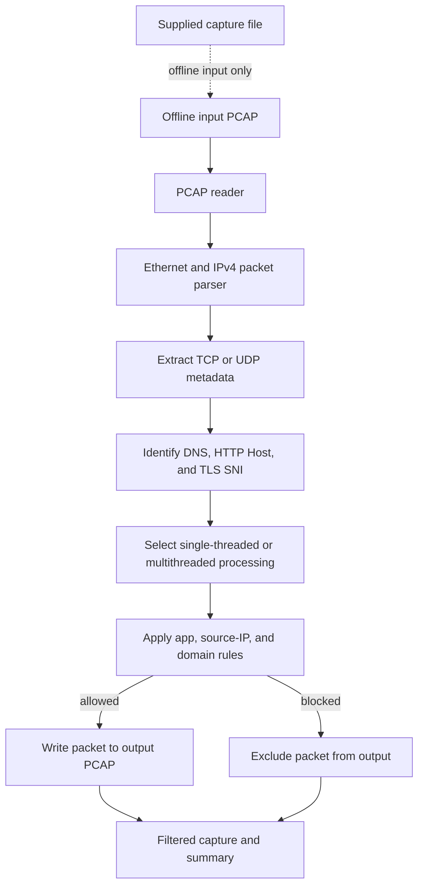

<p align="center">
  
</p>

<h1 align="center">Computer Networks Based Deep Packet Inspection Project</h1>

This project is a computer networks based Python application for Deep Packet Inspection (DPI). It reads PCAP files, parses Ethernet, IPv4, TCP, and UDP packets, identifies traffic using TLS SNI, HTTP Host, and DNS queries, and filters packets with blocking rules based on app name, source IP, or domain substring.

The engine reads an offline PCAP, extracts supported protocol metadata, applies configured block rules, and writes the resulting packet capture. It supports single-threaded and multi-threaded processing modes.



The tool operates on supplied capture files rather than intercepting live traffic. Matching is limited to the protocols and metadata the parser can recognize; encrypted payload contents are not decrypted.

## Project Structure

- `main.py` command-line entry point
- `generate_test_pcap.py` test traffic generator
- `src/` packet parser, PCAP reader, extractors, rules, and engine logic
- `tests/test_dpi.py` unit and integration tests

## Features

- PCAP file reading and writing
- Packet parsing for Ethernet, IPv4, TCP, and UDP
- Traffic identification from TLS, HTTP, and DNS payloads
- Blocking by app, IP address, or domain keyword
- Single-threaded and multi-threaded processing modes

## Usage

```bash
python main.py <input.pcap> <output.pcap> [options]
```

Example:

```bash
python main.py test_dpi.pcap output.pcap --block-app YouTube
```

## Test

```bash
python -m unittest discover -s tests -v
```

